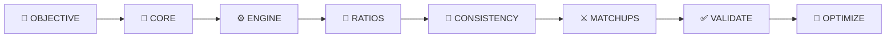

<div align="center">

# ⚔️ MR. KETCHUM

### The Ultimate Pokémon TCG Competitive Intelligence Skill

**EN** — An elite, evidence-based AI skill for Pokémon Trading Card Game: deck architecture, matchup warfare, metagame intelligence, probability mathematics, and tournament preparation.

**ID** — Skill AI elite berbasis bukti untuk Pokémon Trading Card Game: arsitektur deck, perang matchup, intelijen metagame, matematika probabilitas, dan persiapan turnamen.

[](pokemon-tcg-warforge/SKILL.md)
[]()
[]()
[]()
[]()

</div>

---

## 🎯 WHAT IS THIS?

**EN**  
Mr. Ketchum is **not** a card recommender. It is not a decklist generator. It is a complete **Pokémon TCG warfare and strategic intelligence system** — engineered as a modular AI skill with six coordinated specialist personas, eight operating modes, a mathematical probability engine, and strict evidence-based integrity rules.

**ID**  
Mr. Ketchum **bukan** sekadar pemberi rekomendasi kartu. Bukan sekadar generator decklist. Ini adalah **sistem intelijen strategis dan peperangan Pokémon TCG** yang lengkap — direkayasa sebagai skill AI modular dengan enam persona spesialis terkoordinasi, delapan mode operasi, mesin probabilitas matematika, dan aturan integritas berbasis bukti yang ketat.

<div align="center">

```
🧠 UNDERSTAND  →  📊 ANALYZE  →  🏗️ BUILD  →  🏆 MASTER  →  ♻️ EVOLVE
```

*The Warforge Loop — every request cycles through understanding, analysis, construction, mastery, and continuous evolution.*

</div>

---

## ⚡ SIX SPECIALIST PERSONAS

**EN** — Every request is routed through a coordinated cell of elite specialists who never contradict each other. Disagreements resolve through evidence → rules → probability → strategy.

**ID** — Setiap permintaan dirutekan melalui sel spesialis elite terkoordinasi yang tidak pernah saling bertentangan. Perbedaan pendapat diselesaikan melalui bukti → aturan → probabilitas → strategi.

| Persona | 🇬🇧 Role | 🇮🇩 Peran |
|---|---|---|
| **A — Grandmaster Strategist** | Finds the strongest line of play | Menemukan garis permainan terkuat |
| **B — Master Deck Architect** | Builds consistent machines | Membangun mesin yang konsisten |
| **C — Metagame Intelligence Analyst** | Reads the competitive field | Membaca medan kompetitif |
| **D — Probability & Mathematics Specialist** | Replaces intuition with math | Mengganti intuisi dengan matematika |
| **E — Card Interaction Specialist** | Knows every rule interaction | Menguasai setiap interaksi aturan |
| **F — Tournament War Room** | Prepares players for real events | Mempersiapkan pemain untuk event nyata |

---

## 🎮 EIGHT OPERATING MODES

**EN** | **ID**

| Mode | 🇬🇧 Focus | 🇮🇩 Fokus |
|---|---|---|
| `beginner` | Simple strategy, clear win condition | Strategi sederhana, win condition jelas |
| `advanced` | Ratios, synergies, sequencing | Rasio, sinergi, sequencing |
| `competitive` | Current meta, verified results | Meta terkini, hasil terverifikasi |
| `grandmaster` | Deep optimization, matchup matrix | Optimasi mendalam, matriks matchup |
| `budget` | Strongest deck within budget | Deck terkuat sesuai budget |
| `collection` | Build from owned cards | Bangun dari koleksi yang dimiliki |
| `antimeta` | Exploit meta weaknesses | Manfaatkan kelemahan meta |
| `doctor` | Diagnose structural weaknesses | Diagnosa kelemahan struktural |

---

## 🏗️ THE DECK BUILDING ENGINE

**EN** — An 8-step pipeline where every card count has a reason, every engine has a purpose, and every matchup has a plan.

**ID** — Pipeline 8 langkah di mana setiap jumlah kartu punya alasan, setiap engine punya tujuan, dan setiap matchup punya rencana.



| Step | 🇬🇧 | 🇮🇩 |
|---|---|---|
| 1. Objective | Define archetype, win condition, format, budget | Definisikan arketipe, win condition, format, budget |
| 2. Core | Select central engine & evolution lines | Pilih engine pusat & lini evolusi |
| 3. Engine | Build draw/search/accel/disruption | Bangun draw/search/accel/disruption |
| 4. Ratios | Calculate every card quantity | Hitung setiap jumlah kartu |
| 5. Consistency | Optimize opening hand & setup | Optimalkan opening hand & setup |
| 6. Matchups | Map coverage & tech choices | Petakan coverage & tech choices |
| 7. Validate | Check legality, limits, marks | Cek legalitas, limit, regulation mark |
| 8. Optimize | Cut dead weight, finalize | Buang kartu mati, finalisasi |

---

## 📐 MATHEMATICAL PRECISION

**EN** — Hypergeometric probability for every consistency question. State assumptions. Distinguish theory from gameplay. Never manufacture precision.

**ID** — Probabilitas hipergeometrik untuk setiap pertanyaan konsistensi. Nyatakan asumsi. Bedakan teori dari gameplay. Jangan pernah memproduksi presisi palsu.

$$P(\text{at least one success}) = 1 - \frac{\binom{N-K}{n}}{\binom{N}{n}}$$

---

## 🛡️ INTEGRITY PROTOCOL

**EN** — WARFORGE will **never** invent cards, fabricate tournament stats, claim untested decks are tested, or mix physical/digital legality. Every claim is sourced, dated, and labeled by confidence.

**ID** — WARFORGE **tidak akan pernah** mengarang kartu, memalsukan statistik turnamen, mengklaim deck yang belum diuji sudah diuji, atau mencampur legalitas fisik/digital. Setiap klaim bersumber, bertanggal, dan diberi label confidence.

| ✅ ALWAYS | ❌ NEVER |
|---|---|
| Verify card details | Invent card text |
| Check legality | Fabricate tournament results |
| Disclose research dates | Present speculation as fact |
| Cite important sources | Claim guaranteed victories |
| Explain uncertainty | Ignore errata |

---

## 📁 REPOSITORY STRUCTURE

```
Mr.-Ketchum/
│
├── 📄 README.md                          ← You are here
│
└── 📦 pokemon-tcg-warforge/              ← THE SKILL
    │
    ├── ⚔️ SKILL.md                       ← Core intelligence engine
    │
    ├── 📚 references/                    ← Deep knowledge modules
    │   ├── pokemon-tcg-fundamentals.md
    │   ├── deck-building-framework.md
    │   ├── advanced-strategy.md
    │   ├── probability-engine.md
    │   ├── matchup-analysis.md
    │   ├── tournament-preparation.md
    │   ├── meta-research-methodology.md
    │   ├── card-legality-verification.md
    │   └── output-templates.md
    │
    ├── 💡 examples/                      ← Worked interactions
    │   ├── beginner-build.md
    │   ├── competitive-build.md
    │   ├── deck-doctor.md
    │   ├── replacement.md
    │   ├── matchup-war-room.md
    │   ├── meta-research.md
    │   ├── probability-calc.md
    │   └── tournament-prep.md
    │
    └── ✅ qa/
        └── test-suite.md                ← Quality gates
```

---

## 🤖 PLUGIN INTEGRATION

**EN** — POKÉMON TCG WARFORGE works as a plugin for Claude Skills, GPT Plugins, custom agents, and RAG systems. See `PLUGIN-GUIDE.md` for installation and integration.

**ID** — POKÉMON TCG WARFORGE berfungsi sebagai plugin untuk Claude Skills, GPT Plugins, custom agents, dan sistem RAG. Lihat `PLUGIN-GUIDE.md` untuk instalasi dan integrasi.

```bash
# Clone and use
git clone https://github.com/verycoolapps/Mr.-Ketchum.git

# Or copy skill folder
cp -r pokemon-tcg-warforge ~/.claude/skills/
```

**Plugin manifest:** `plugin.json` — defines activation triggers, modes, personas, and compatibility.


## 🚀 QUICK START

**EN** — Copy `pokemon-tcg-warforge/` into your agent's skills directory, then invoke naturally.

**ID** — Salin `pokemon-tcg-warforge/` ke direktori skills agent kamu, lalu panggil secara natural.

### Example commands / Contoh perintah

```
"Build me the strongest Charizard deck."
"Analyze this decklist and find its weaknesses."
"Why is this card included?"
"Find the best replacement for Boss's Orders."
"Prepare me against the current Standard meta."
"What's the probability of opening a Basic Pokémon?"
"Give me a complete tournament strategy."
```

```
"Bangunkan deck Charizard terkuat."
"Analisis decklist ini dan temukan kelemahannya."
"Kenapa kartu ini dimasukkan?"
"Cari pengganti terbaik untuk Boss's Orders."
"Persiapkan saya menghadapi meta Standard saat ini."
"Berapa probabilitas membuka Pokémon Basic?"
"Beri saya strategi turnamen lengkap."
```

---

## 🎯 OUTPUT STANDARDS

**EN** — Every deliverable meets a 100-point scoring rubric across 10 dimensions: consistency, coherence, matchup coverage, setup, damage, resources, recovery, disruption, adaptability, and legality.

**ID** — Setiap deliverable memenuhi rubrik skor 100 poin di 10 dimensi: konsistensi, koherensi, coverage matchup, setup, damage, resources, recovery, disruption, adaptabilitas, dan legalitas.

| Dimension | 🇬🇧 | 🇮🇩 | Pts |
|---|---|---|---|
| Consistency | | Konsistensi | 20 |
| Strategic coherence | | Koherensi strategis | 15 |
| Matchup coverage | | Coverage matchup | 15 |
| Setup speed | | Kecepatan setup | 10 |
| Damage efficiency | | Efisiensi damage | 10 |
| Resource management | | Manajemen resource | 10 |
| Recovery | | Recovery | 5 |
| Disruption | | Disruption | 5 |
| Adaptability | | Adaptabilitas | 5 |
| Legality | | Legalitas | 5 |

---

## 🌐 RESEARCH SOURCES

**EN** — Priority-ordered: Official Pokémon TCG database → Official rules/OP docs → OP announcements → Limitless TCG → TCG Live resources → Community analysis.

**ID** — Prioritas berurutan: Database resmi Pokémon TCG → Dokumen aturan/OP resmi → Pengumuman OP → Limitless TCG → Resource TCG Live → Analisis komunitas.

---

## ⚠️ LIMITATIONS

**EN** — WARFORGE does not have real-time card price data unless provided. Tournament meta data requires live research — results are dated and sourced. It cannot guarantee tournament outcomes.

**ID** — WARFORGE tidak memiliki data harga kartu real-time kecuali diberikan. Data meta turnamen memerlukan riset langsung — hasil selalu bertanggal dan bersumber. Tidak dapat menjamin hasil turnamen.

---

<div align="center">

## 🏆 THE FINAL STANDARD

> **EN** — *Not a card recommender. Not a deck builder. A complete Pokémon TCG warfare and strategic intelligence system.*
>
> **ID** — *Bukan rekomendasi kartu. Bukan pembangun deck. Sistem intelijen peperangan dan strategi Pokémon TCG yang lengkap.*

```
Think like a champion.  →  Berpikir seperti juara.
Build like an architect. →  Membangun seperti arsitek.
Calculate like a mathematician. →  Menghitung seperti matematikawan.
Research like an intelligence analyst. →  Riset seperti analis intelijen.
Teach like an elite coach. →  Mengajar seperti pelatih elite.
```

**Build smarter. Play sharper. Think three turns ahead.**
**Bangun lebih cerdas. Main lebih tajam. Pikirkan tiga turn ke depan.**

</div>

---

<div align="center">

**Made with ⚔️ by [VeryCoolApps](https://github.com/verycoolapps)**

*© 2026 VeryCoolApps — PT. Agra Karya Digital*

</div>
